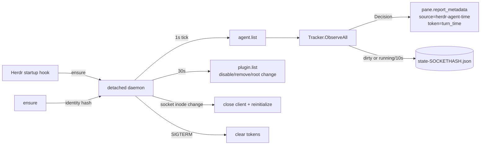

# Repository Guidelines

## Project Overview

`herdr-agent-time` is a Herdr plugin that shows each agent's turn runtime in the
sidebar. A detached daemon polls Herdr once per second, tracks per-pane turn
state, and writes a `turn_time` metadata token. Live turns tick (`0:07`);
completed turns stay frozen (`1:42`) until the next turn starts. The daemon
watches the plugin registry and exits when the plugin is disabled, removed, or
reinstalled from another root.

Module: `github.com/cmalec/herdr-agent-time`. License: MIT. Targets macOS and
Linux only. Runtime code uses the Go standard library only; tests use
`github.com/stretchr/testify`. The module requires Go 1.27.3.

## Architecture & Data Flow



- `main.go` dispatches subcommands: `ensure`/`start`, `daemon`, `stop`,
  `status`. `ensure` starts a detached `daemon` with `Setsid` and records the
  executable path and SHA-256 in `daemon-SOCKETHASH.json`. It replaces a
  daemon whose identity differs, so updates and rebuilds take effect. The flock
  file, not the PID file, is the single-instance source of truth.
- `daemon.go` owns the polling loop, write acknowledgement, state-save
  backoff, socket reconnects, and the plugin-registry watchdog. The loop is
  testable with a fake client and manual tick channel.
- `client.go` owns one reused Unix-socket connection and a newline-delimited
  JSON RPC protocol. It calls `agent.list`, `plugin.list`, and
  `pane.report_metadata`, dials with a 2s timeout, sets a 3s call deadline, and
  retries transport failures once. Deterministic API errors are not retried.
  Every network method takes `context.Context` first; the daemon propagates
  its signal context so shutdown cancels polling.
- `tracker.go` is a pure state machine. `ObserveAll(agents, now)` returns
  `[]Decision` plus a dirty flag. The caller sends each decision, then calls
  `MarkReported` or `MarkCleared` only after a successful write. Keep that
  separation: retries depend on unacknowledged state staying pending.
- Live decisions carry a 3s TTL so a dead daemon leaves no stale timer.
  Completed decisions have no TTL and are replayed after a Herdr server restart.
- Turn rules: first `working` observation starts a turn; `blocked` keeps it
  counting; any other status freezes it. A completed value survives restarts.
  A running turn resumes only when `state_change_seq` is unchanged; otherwise
  it starts fresh, or freezes at `LastSeenMS` if the turn ended while away.
- A pane is removed after three consecutive snapshots omit it. An agent
  replacement clears the old token. Socket inode changes close the cached
  connection and trigger `Tracker.Reinitialize()` to reconcile with a
  restarted server.
- The sidebar row is manual. `README.md` gives the TOML snippet and a short
  agent prompt. Do not add a config-writing action without validating the
  candidate with `herdr config check` first.
- `stop` clears the token and removes the state file. It is a reset, not a
  pause. A later `start` begins with no history.

State, lock, PID, identity, and log files are keyed by the first 8 hex bytes of
SHA-256 of `HERDR_SOCKET_PATH`, so separate Herdr sessions do not share state.

## Key Directories

The repository has no subpackages; all Go files are `package main` at the root.

| Path                 | Purpose                                            |
| -------------------- | -------------------------------------------------- |
| `/`                  | CLI, daemon loop, tracker, client, and their tests |
| `bin/`               | Build output; only `.gitkeep` is committed         |
| `docs/assets/`       | README images                                      |
| `.agents/rules/`     | Vendored Go documentation rule                     |
| `.agents/skills/`    | Scoped-commit and `herdr-plugin-reference` skills  |
| `.github/workflows/` | CI workflow                                        |
| Herdr state dir      | Runtime JSON state and logs; never committed       |

## Development Commands

Use the Makefile targets; CI invokes the same commands.

| Target           | Purpose                                  |
| ---------------- | ---------------------------------------- |
| `make build`     | Build `bin/herdr-agent-time`             |
| `make test`      | Run unit tests                           |
| `make test-race` | Run tests with the race detector         |
| `make check`     | Check formatting, run vet, and run tests |
| `make lint`      | Run golangci-lint                        |
| `make cover`     | Write and print coverage                 |
| `make fmt`       | Format all Go files                      |
| `make clean`     | Remove build and coverage output         |

Build the binary where the manifest expects it:

```sh
make build
```

Run the full local check:

```sh
make check
```

Link a local checkout into Herdr:

```sh
herdr plugin link "$PWD"
```

Start the daemon through the plugin action:

```sh
herdr plugin action invoke cmalec.agent-time.start
```

Linking does not run the manifest's `[[build]]` command; build first.
`make ci` runs the full CI sequence locally.

## Code Conventions & Common Patterns

- Keep runtime code dependency-free; `testify` is the only test dependency.
- Separate concerns by file: CLI, paths, identity, and process lifecycle in
  `main.go`; polling, persistence cadence, and the plugin watchdog in
  `daemon.go`; pure timer logic in `tracker.go`; socket RPC in `client.go`.
- Network and blocking APIs take `context.Context` as the first parameter.
  Never store a context in a struct. Document fallback timeouts.
- Return errors; wrap them with `%w`. `main` prints user-facing errors once and
  exits 1 (usage errors exit 2). The daemon logs and continues instead of
  exiting on transient socket or report failures.
- Inject time into the tracker. Methods take `now time.Time`; use
  `UnixMilli` internally. Never call `time.Now()` inside `Tracker`.
- Treat `Decision` as data, not an action. `ObserveAll` must not perform I/O.
- Persist state as compact 0600 JSON via temp file plus rename. Bump
  `stateFile.Version` and handle older versions if the schema changes.
- Save state when it changes, and periodically only while a turn is running.
  Failed saves use a 30s backoff and throttled logs. Do not retry every tick.
- Watch `plugin.list` about every 30s. Exit when this plugin is disabled,
  removed, or installed from another root. Use the daemon identity file to
  replace a stale executable after an update, relink, or rebuild.
- Preserve the exact integration names: source `herdr-agent-time`, token
  `turn_time`, plugin id `cmalec.agent-time`, and statuses
  `working`/`blocked`/`done`/`idle`.
- Throttle repeated daemon logs: 30s for `agent.list` failures, 5s for report
  failures. After 300 consecutive list failures, exit cleanly.
- Run `gofmt`; document every exported identifier. Package documentation lives
  in `doc.go`, runnable examples in `example_test.go`, and user documentation
  in `README.md` (see `.agents/rules/golang-docs.md`).
- Write table-driven tests with `testify/assert` and `testify/require`; use
  `t.Run` for each case.

### Gotchas

- Do not add a TTL to completed values. Only live values use the 3s TTL.
- Keep `HadToken` when an agent changes; otherwise no clear is sent.
- Do not drop a pane on one missing snapshot; the grace period is intentional.
- `resolvePaths` requires `HERDR_SOCKET_PATH`. Running the binary outside Herdr
  fails for commands that resolve paths.
- `status` reads the state file only; it does not query live agents. When the
  daemon is down, a running value uses `LastSeenMS` and is marked stale; do not
  extend it with `time.Now()`.
- The README's state-directory example is Herdr's injected plugin path. The
  code's fallback path is different.
- Herdr resets `state_change_seq` on a server restart. The "same sequence"
  resume branch applies to a daemon restart, not a server restart.
- `stop` removes the state file after the daemon exits. Do not change it to a
  pause without also changing the token-clear behavior and the README.
- The platform is POSIX-specific: `syscall.Flock`, `Setsid`, and Unix sockets
  rule out Windows.

## Important Files

| File                                             | Role                                                                                |
| ------------------------------------------------ | ----------------------------------------------------------------------------------- |
| `main.go`                                        | CLI dispatch, path resolution, identity, locking, ensure/stop/status, daemon wiring |
| `daemon.go`                                      | Polling loop, plugin watchdog, state-save cadence, shutdown                         |
| `tracker.go`                                     | `AgentInfo`, `PaneState`, `Tracker`, decisions, persistence                         |
| `client.go`                                      | Herdr Unix-socket JSON-lines client                                                 |
| `herdr-plugin.toml`                              | Build, startup, and three global actions; keep commands in sync with `main.go`      |
| `doc.go`                                         | Package-level architecture and command documentation                                |
| `example_test.go`                                | Compiler-checked duration formatting example                                        |
| `tracker_test.go`                                | State-machine, restart, formatting, and persistence tests                           |
| `daemon_test.go`                                 | Tick, watchdog, save backoff, inode, and shutdown tests                             |
| `client_test.go`                                 | Fake Unix-socket RPC tests, retries, errors, and cancellation                       |
| `main_test.go`                                   | Path, identity, status duration, locking, PID, and socket inode tests               |
| `.agents/skills/herdr-plugin-reference/SKILL.md` | Herdr manifest, lifecycle, metadata, and socket contract                            |
| `Makefile`                                       | Build, test, coverage, formatting, and CI targets                                   |
| `.github/workflows/ci.yml`                       | Ubuntu/macOS CI using `make check`, race tests, golangci-lint, and build            |
| `README.md`                                      | User-facing install, sidebar, lifecycle, development, and limits                    |
| `go.mod`                                         | Module path, Go version, and test dependency                                        |

## Runtime/Tooling Preferences

- Go 1.27.3 language level; the module has no `toolchain` directive. Runtime
  code has no dependencies; `github.com/stretchr/testify` is test-only.
- Herdr `>= 0.9.0`. macOS and Linux only.
- Build from the repository root with `make build`; the manifest invokes
  `go build -trimpath -o bin/herdr-agent-time .`.
- Use `bin/` for all compiled output. Do not commit the binary.
- CI runs on Ubuntu and macOS from `.github/workflows/ci.yml`.

| Variable                 | Use                                                                                  |
| ------------------------ | ------------------------------------------------------------------------------------ |
| `HERDR_SOCKET_PATH`      | Required; selects the Herdr socket and keys state files                              |
| `HERDR_PLUGIN_STATE_DIR` | State directory; falls back to `XDG_STATE_HOME` or `~/.local/state/herdr-agent-time` |
| `HERDR_PLUGIN_ROOT`      | Plugin installation root; recorded in the identity and checked by the watchdog       |
| `HERDR_PLUGIN_ID`        | Enables the daemon's plugin-registry watchdog when it equals `cmalec.agent-time`     |

## Testing & QA

- Use `testify/assert` and `testify/require`. Every test is table-driven with
  `t.Run`; keep cases independent and ordered only when a scenario requires it.
- Tests are hermetic: fixed `time.Unix(1_700_000_000, 0)` values,
  `t.TempDir()`, and no real Herdr daemon or subprocess. `client_test.go` uses a
  fake Unix-socket JSON-RPC server.
- Tests live beside the code in `package main` and may inspect unexported state
  such as `tracker.Panes`.
- Reuse the `observation`, `observeOne`, and `report` helpers for tracker
  scenarios.
- State-machine changes need coverage for working, blocked, completion, new
  turn, restart reconciliation, missing-pane grace, agent replacement, and
  token clear/replay.
- Daemon changes need coverage for reporting, save backoff, idle save skipping,
  plugin disable/remove/root change, inode reconnect, list-failure exit,
  shutdown clearing, and context cancellation.
- Identity/status changes need coverage for path isolation, identity matching,
  identity round-trip, and stale status duration.
- `ensureDaemon`, `stopDaemon`, and `printStatus` output still need a real Herdr
  instance or a focused integration test. Do not claim coverage from the unit
  suite for their subprocess and output behavior.
- CI runs `make check`, `make test-race`, golangci-lint, and `make build` on
  Ubuntu and macOS. There is no coverage threshold. Run `make check` and
  `make lint` before finishing.
