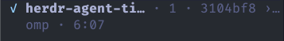

# herdr-agent-time

A [Herdr](https://herdr.dev) plugin that shows each agent's current turn
runtime in the sidebar. While the agent works, the value ticks every second.
When the turn ends, the final duration stays visible until the next turn starts
(or until the agent exits).



Published as a community plugin. Herdr discovers community plugins on GitHub
automatically through the `herdr-plugin` topic.

The timer starts on the first `working` observation, keeps counting while the
agent is `blocked` waiting for input, and freezes on `done`, `idle`, or
`unknown`. Completed values are persisted under Herdr's plugin state directory
and replayed after a Herdr server restart.

A daemon restart resumes a live turn when `state_change_seq` is unchanged.
Herdr resets that sequence on a server restart. After a server restart, a
still-working turn starts a fresh timer, a blocked turn keeps its start, and a
turn that ended while the daemon was away freezes at its last observed time.

## Install

From GitHub:

```sh
herdr plugin install cmalec/herdr-agent-time
```

For local development, build the binary first:

```sh
make build
```

Link the checkout:

```sh
herdr plugin link "$PWD"
```

Start the daemon through the plugin action:

```sh
herdr plugin action invoke cmalec.agent-time.start
```

Herdr runs the build command during a GitHub install, so Go 1.27.3 or newer
must be on `PATH`. Linking a local checkout does not run build commands; build
it yourself first.

## Sidebar Row

Herdr does not expose a socket API for editing `config.toml`. Add the row by
hand, or give your agent the prompt below.

If `[ui.sidebar.agents]` is absent, add this table:

```toml
[ui.sidebar.agents]
rows = [
  ["state_icon", "machine", "workspace", "tab"],
  ["agent", "$turn_time"],
]
```

If the table already exists, keep your layout and add `"$turn_time"` to the row
that contains `"agent"`:

```toml
["agent", "$turn_time"]
```

If no row contains `"agent"`, add that row. `[ui.sidebar.agents.rows_by_agent]`
overrides replace the main `rows` array.
Add `"$turn_time"` to each override that should show the timer.

Validate and reload Herdr after the edit:

```sh
herdr config check
herdr server reload-config
```

The token is absent before the first turn and after `stop`. A completed value
stays visible until the next turn starts, the agent changes, or the pane
closes. Values use `m:ss`, or `h:mm:ss` after one hour.

### Agent Prompt

Copy this to a coding agent:

```text
Install and configure the Herdr Agent Time plugin.

1. Run: herdr plugin install cmalec/herdr-agent-time
2. Open the Herdr config at $HERDR_CONFIG_PATH or ~/.config/herdr/config.toml.
   Add "$turn_time" to the [ui.sidebar.agents] row that contains "agent".
   If the table is absent, add this table:
   [ui.sidebar.agents]
   rows = [
     ["state_icon", "machine", "workspace", "tab"],
     ["agent", "$turn_time"],
   ]
   If no row contains "agent", add ["agent", "$turn_time"] as a new row.
   Keep all existing tokens and rows.
   If [ui.sidebar.agents.rows_by_agent] overrides exist, add "$turn_time" to
   each override that should show the timer.
3. Run: herdr plugin action invoke cmalec.agent-time.start
4. Run: herdr config check
5. Run: herdr server reload-config
6. Run: herdr plugin action invoke cmalec.agent-time.status

Show the config diff before writing. Do not replace unrelated settings.
```

## Lifecycle

The plugin manifest starts a detached timer daemon from Herdr's startup hook.
Actions are available under the `cmalec.agent-time` plugin id:

| Action      | Command                                               |
| ----------- | ----------------------------------------------------- |
| Start timer | `herdr plugin action invoke cmalec.agent-time.start`  |
| Stop timer  | `herdr plugin action invoke cmalec.agent-time.stop`   |
| Show status | `herdr plugin action invoke cmalec.agent-time.status` |

The daemon talks to Herdr over its Unix socket. It reads `agent.list` once per
second and writes one `$turn_time` pane token per active agent. A running value
has a three-second TTL, so a stopped daemon leaves no stale live timer. A
completed value has no TTL and is replayed after reconnecting to a restarted
Herdr server.

`stop` clears the displayed token and removes persisted timer state. A later
`start` begins with no history. This is intentional: stop is a reset, not a
pause.

The daemon watches the plugin registry. It exits when the plugin is disabled,
removed, or installed from a different root. This prevents a stale daemon from
writing tokens after the plugin is gone.

`ensure` records the running executable path and hash. It replaces an older
daemon after a plugin update, a relink, or a local rebuild. After
`herdr plugin update`, run the start action or restart Herdr to start the new
version. Run `stop` before uninstalling. Stop clears tokens even when the daemon
is already dead, as long as the server is reachable. If the server is
unreachable, its token state cannot be cleared.

State and logs live under Herdr's `HERDR_PLUGIN_STATE_DIR` (for example
`~/.local/state/herdr/plugins/cmalec.agent-time/`). State files are keyed by
the socket path, so separate Herdr sessions do not share pane state.

## Development

Package documentation lives in `doc.go`, and compiler-checked examples live in
`example_test.go`. The Herdr plugin and socket contract is summarized in
`.agents/skills/herdr-plugin-reference/SKILL.md`.

| Target           | Purpose                                  |
| ---------------- | ---------------------------------------- |
| `make build`     | Build `bin/herdr-agent-time`             |
| `make test`      | Run unit tests                           |
| `make test-race` | Run unit tests with the race detector    |
| `make check`     | Check formatting, run vet, and run tests |
| `make lint`      | Run golangci-lint                        |
| `make ci`        | Run check, race tests, lint, and build   |
| `make cover`     | Write and print statement coverage       |
| `make fmt`       | Format all Go files                      |
| `make clean`     | Remove the binary and coverage file      |

Build the plugin binary:

```sh
make build
```

Run the full local check:

```sh
make check
```

## Limitations

- The timer starts when the daemon first observes a working agent. A turn that
  began before the plugin started is timed from that first observation.
- The plugin relies on Herdr's semantic `working` / `blocked` / `done` / `idle`
  state. Panes without a detected or reported agent are ignored.
- A blocked agent keeps the timer running for the whole wait. This is a display
  choice, not a measure of active computation.
- The daemon polls once per second. A very short turn can start and end between
  two observations and never appear.
- macOS and Linux only; the manifest omits Windows.
